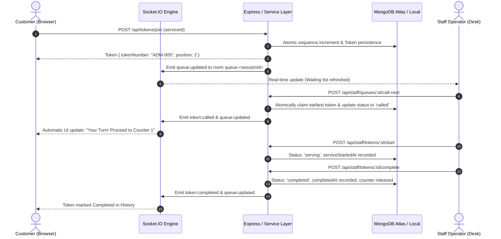

video link = https://drive.google.com/file/d/1HxeAYE55c9DWNrbufhu74jggMb_fe4Yd/view?usp=drive_link


# QueueLess — Real-Time Queue & Appointment Management SaaS Platform

> **End-Term Project & Viva Showcase**  
> Built with the complete **MERN Stack** (MongoDB, Express.js, React, Node.js), **Tailwind CSS**, and **Socket.IO** for live real-time bidirectional queue synchronization.

---

## 1. Product Vision & Problem Solved

**QueueLess** solves the widespread problem of long, chaotic, and frustrating physical queues at high-footfall organizations such as:
- **Hospitals & Outpatient Clinics (OPD)**: Patient triage and token calling.
- **University & College Administration**: Registrar document validation and transcript counters.
- **Banks & Service Desks**: Cash counters, loan inquiries, and account verification.
- **Government & Civic Offices**: Identity desks and license counters.

### Core Capabilities:
- **Virtual Queuing**: Customers join queues from their phone or browser, get formatted digital tokens (e.g. `ADM-014`, `OPD-002`), and track dynamic position without standing in line.
- **Real-Time Synchronized Screen**: When staff members call the next token or change queue state, customer dashboards update instantly via WebSockets without page reload.
- **Staff Operations Console**: Streamlined single-counter desk controls (`Call Next`, `Start Service`, `Complete Service`, `Skip`, `Mark No-Show`).
- **Administrator Business Intelligence**: Live metrics computed via MongoDB aggregation pipelines (waiting customers, served today, average wait time, average service duration, cancellation rates) with visual **Recharts**.

---

## 2. Technology Stack

| Layer | Technologies |
|---|---|
| **Frontend** | React 18, Vite, Tailwind CSS v3, React Router v6, Axios, Socket.IO Client, Lucide React, Recharts |
| **Backend** | Node.js (v24), Express.js, MongoDB, Mongoose 8, Socket.IO, JWT, bcryptjs, Helmet, Cookie-Parser |
| **Testing** | Node Native Test Runner (`node:test`, `node:assert`), Supertest |
| **Styling & Tokens** | Curated B2B SaaS design system (`#14213D` Navy, `#4F46E5` Indigo, `#0D9488` Teal, `#F6F8FC` Surface) |

---

## 3. Architecture & Real-Time Flow



---

## 4. Quick Start & Setup Instructions

### Prerequisites
- Node.js (v18 or higher, tested on Node v24)
- Local MongoDB running on `mongodb://127.0.0.1:27017` or MongoDB Atlas URI

### Step 1: Backend Setup
```bash
cd last_end_term_project/backend

# Install dependencies (already installed)
npm install

# Run safe demo seed script (populates demo admin, staff, customers, and active sessions)
npm run seed

# Run automated backend test suite (14 passing tests)
npm test

# Start the backend server
npm start
# Server listens at http://localhost:5000
```

### Step 2: Frontend Setup
```bash
cd last_end_term_project/frontend

# Install dependencies (already installed)
npm install

# Start Vite React development server
npm run dev
# App is accessible at http://127.0.0.1:5173
```

---

## 5. Demo Accounts for College Viva Presentation

The database seed script sets up one-click demo credentials directly on the login page:

| Role | Email | Password | Assigned Counter / Permissions |
|---|---|---|---|
| **Administrator** | `admin@queueless.com` | `Admin@123` | Full access: Services CRUD, sessions, analytics, user promotions |
| **Staff Member 1** | `staff.sarah@queueless.com` | `Staff@123` | Campus Health Clinic (OPD) Desk |
| **Staff Member 2** | `staff.alex@queueless.com` | `Staff@123` | Student Administration (ADM) Counter |
| **Customer 1** | `john.customer@gmail.com` | `Customer@123` | Holds currently serving token **ADM-003** |
| **Customer 2** | `emma.customer@gmail.com` | `Customer@123` | Holds waiting token **ADM-005** |
| **Customer 3** | `david.customer@gmail.com` | `Customer@123` | Holds waiting token **ADM-004** |

---

## 6. REST API Endpoint Reference

### Authentication (`/api/auth`)
- `POST /register`: Register new customer account
- `POST /login`: Log in (Customer, Staff, or Admin) and receive JWT
- `POST /logout`: Clear session cookie
- `GET /me`: Get authenticated user profile & active token
- `PUT /profile`: Update display name

### Services (`/api/services`)
- `GET /`: Get all active services with real-time queue summaries
- `GET /:id`: Get single service details
- `POST /` *(Admin)*: Create new service counter desk
- `PUT /:id` *(Admin)*: Update service metadata & staff assignments
- `DELETE /:id` *(Admin)*: Deactivate service

### Queue Sessions (`/api/queues`)
- `GET /:sessionId/summary`: Authoritative queue snapshot (waiting, serving, wait time)
- `GET /sessions` *(Staff/Admin)*: List all operating sessions
- `PATCH /:sessionId/status` *(Staff/Admin)*: Open, pause, or close queue

### Token Operations (`/api/tokens`)
- `POST /join` *(Customer)*: Join virtual queue with concurrency safety
- `GET /my-active` *(Customer)*: Get customer's live token & position
- `GET /my-history` *(Customer)*: Get customer's past token log
- `POST /:id/cancel` *(Customer)*: Cancel waiting token
- `POST /walk-in` *(Staff/Admin)*: Issue walk-in / manual token for in-person visitors

### Staff Controls (`/api/staff`)
- `GET /dashboard` *(Staff/Admin)*: Operator desk view & active token
- `POST /queues/:sessionId/call-next`: Atomically call earliest token
- `POST /tokens/:tokenId/start`: Transition token from `called` -> `serving`
- `POST /tokens/:tokenId/complete`: Transition token from `serving` -> `completed`
- `POST /tokens/:tokenId/skip`: Mark token as skipped
- `POST /tokens/:tokenId/no-show`: Mark token as no-show

### Analytics & Administration (`/api/analytics`)
- `GET /` *(Staff/Admin)*: MongoDB aggregation metrics (hourly volume, wait times, cancellation rate)
- `GET /staff` *(Admin)*: List staff accounts for assignments
- `GET /users` *(Admin)*: List all platform users
- `POST /users` *(Admin)*: Create new user account with any role (`customer`, `staff`, `admin`)
- `PATCH /users/:id` *(Admin)*: Promote/demote role or toggle active state
- `POST /reseed` *(Admin)*: Restore and replenish initial demo services and sample tokens from UI

---

## 7. Socket.IO Real-Time Event Contract

- **Namespace**: `/`
- **Rooms**:
  - `queue:<queueSessionId>`: Room for all customers & staff viewing a specific queue.
  - `user:<userId>`: Private channel for direct notifications.
- **Emitted Events**:
  - `queue:updated`: Emitted whenever queue state or sequence changes.
  - `token:called`: Emitted when staff calls next token.
  - `token:started`: Emitted when service commences.
  - `token:completed`: Emitted when service finishes.
  - `token:cancelled`: Emitted when customer cancels a token.
  - `token:skipped`: Emitted when token is skipped.
  - `queue:status_changed`: Emitted when queue opens/closes.
  - `your_token:called`: Private notification directly to customer browser.

---

## 8. College Viva Demonstration Script

When presenting to the examiner, follow this 5-minute walkthrough:

1. **Introduction (1 min)**:
   - State the project name (**QueueLess**) and the real-world problem: Eliminating physical lines at clinics and college admin desks.
   - Mention the tech stack: MERN with Socket.IO and Tailwind CSS.
2. **Landing Page & Architecture (1 min)**:
   - Show the public landing page (`http://127.0.0.1:5173/`).
   - Highlight the interactive product preview card and 3-step customer workflow.
3. **Admin & Analytics Demonstration (1.5 min)**:
   - Click **Sign In**, click the one-click **Admin** demo button.
   - Show the **Admin Overview** with live KPIs.
   - Click **Real-Time Analytics** to demonstrate the Recharts visualizations (Hourly Queue Volume line chart, Status Distribution donut, Service Breakdown bar chart).
   - Point out that all numbers are aggregated directly from MongoDB records via aggregation pipelines (`$subtract: ['$serviceStartedAt', '$joinedAt']`), not hardcoded arrays.
4. **Live Real-Time Queue Advancement (1.5 min)**:
   - Open two browser tabs side-by-side:
     - **Tab 1**: Log in as Customer (**Emma** / `emma.customer@gmail.com`). Go to **My Live Queue**. Show her token `ADM-005` with status `waiting` and position `#2`.
     - **Tab 2**: Log in as Staff (**Alex** / `staff.alex@queueless.com`). Go to **Active Queue Counter**.
   - In Tab 2, complete the current serving token (`ADM-003`).
   - Click **Call Next Customer**.
   - Notice that in Tab 1, **the customer's screen updates immediately in real time** without any page reload! The position advances, and when called, a prominent alert banner announces their turn.
5. **Testing & QA Verification**:
   - In terminal, show `npm test` running the 14 automated backend test cases verifying authentication, role guards, concurrency safety, and state machine transitions.
